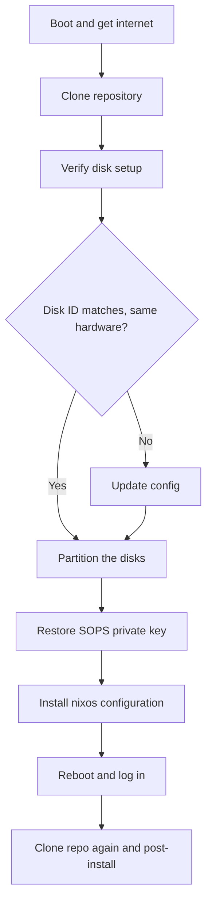

# Installation

This page covers the installation process for this nixos config. It lists the
steps to take before reinstalling or deleting a working install, then the
installation process itself.

## What I need

- USB disk with **Minimal installer** or **Graphical installer** NixOS ISO
- The **age private key** on another USB key or as text backup
- Network access
- This repo as a public URL clonable via https

## Before deleting an installation

Before deleting a working installation to reinstall it on the same laptop or
another one, follow these steps to make sure nothing is missed:

- everything in the **What I need** section is met: USB disk with ISO, USB
disk with **age private key**...
- all your data is backed up to be retrieved after the reinstallation

## Installation

### Overview



### 1. Boot with the minimal NixOS ISO and get network access

On the **Graphical installer** open a terminal and use `nmcli`:

```bash
nmcli device wifi list
nmcli device wifi connect <SSID> password <PASSWORD>
```

Verify the connection works:

```bash
ping -c1 nixos.org >/dev/null && echo "Connected!" || "No connection"
```

### 2. Clone the config's repository via HTTPS

```bash
git clone https://github.com/zivoxroot/flake.git /tmp/flake && cd /tmp/flake
```

### 3. First verify the target device for installation:

```bash
lsblk -o NAME,SIZE,MODEL,TRAN
```

The path disk from these two commands should be the same:

```bash
ls -l /dev/disk/by-id/ | grep -v part
grep "device =" hosts/laptop/disko.nix  # Take the line pointing to the right device
```

The paths will be different if you install on a new machine, if so:

```bash
nixos-generate-config --no-filesystems --show-hardware-config > hosts/laptop-hardware-configuration.nix
```

Copy the disk ID you got with `ls -l /dev/disk/by-id/ | grep -v part` and
replace the line
`device = "/dev/disk/by-id/ata-M.2_SATA_NGFF_1TB_WP4M1TB240810163";`'s ID with
it

### 4. Partition the disks

```bash
sudo nix --extra-experimental-features 'nix-command flakes' run github:nix-community/disko/latest -- --mode destroy,format,mount --flake .#nixos
```

### 5. Restore the sops age key into the persistent subvolume

From the USB key backup:

```bash
# Find the right USB stick
lsblk -f
# Mount it
sudo mkdir /mnt/usb
sudo mount /path/to/usb /mnt/usb

# Copy the secret key
sudo mkdir -p /mnt/persist/var/lib/sops-nix
sudo cp /mnt/usb/key.txt /mnt/persist/var/lib/sops-nix/key.txt
sudo chmod 700 /mnt/persist/var/lib/sops-nix
sudo chmod 600 /mnt/persist/var/lib/sops-nix/key.txt

# Umount the USB
sudo umount /mnt/usb
```

Or from text backup:

```bash
sudo mkdir -p /mnt/persist/var/lib/sops-nix
sudo cat <<'EOF' > /mnt/persist/var/lib/sops-nix/key.txt
<your-private-key>
EOF
sudo chmod 700 /mnt/persist/var/lib/sops-nix
sudo chmod 600 /mnt/persist/var/lib/sops-nix/key.txt
```

### 6. Install

```bash
sudo nixos-install --no-root-passwd --flake .#nixos
```

### 7. Reboot and log in

```bash
sudo reboot now
```

> Don't forget to remove the installation USB key during reboot!

### 8. Clone the repo at the right place via SSH

> Cloning the repo once again adds Github's (or the repo's git forge's) SSH key
> to the SSH host list, allowing you to then push your changes to the repo using
> the copied SSH key (see [secrets management](./secrets.md))

```bash
git clone git@github.com:zivoxRoot/flake.git ~/flake
```

> If you changed anything during the installation (disk configuration for
> example) apply these changes on the new copy and commit them

## Post-installation

- Browser
    - Log in all bookmarked websites (github, mail, AI providers...)
    - Enable extensions, pin and unpin as necessary
- Telegram: login and set preferences
- Steam: login and download favorite games
- Claude Code: login
- Github CLI (`gh`): login (`gh auth login`)
- Syncthing: link to phone and sync
- Reinstall other data backups
